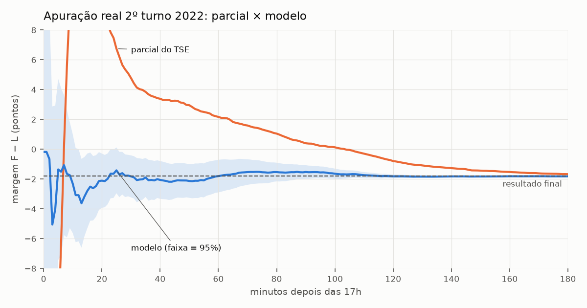
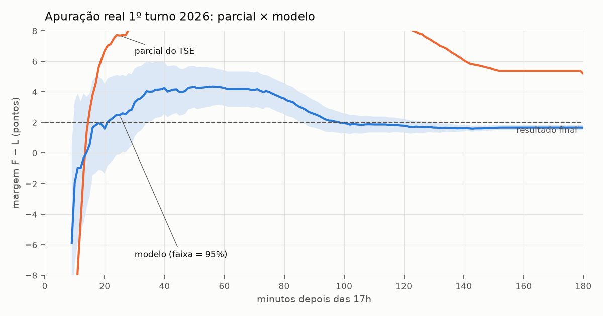
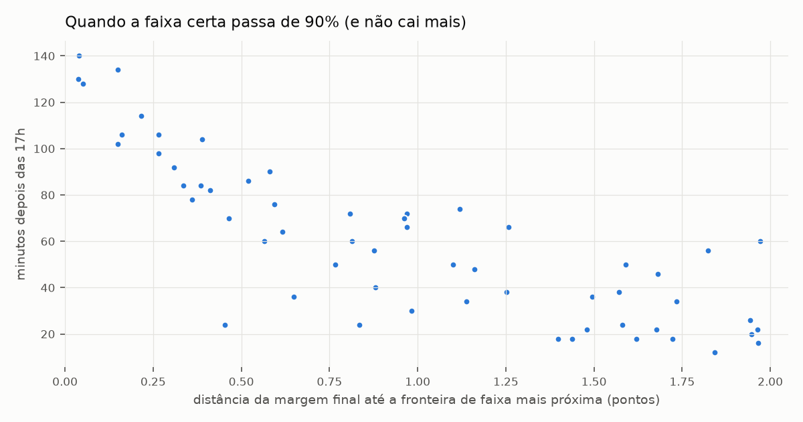
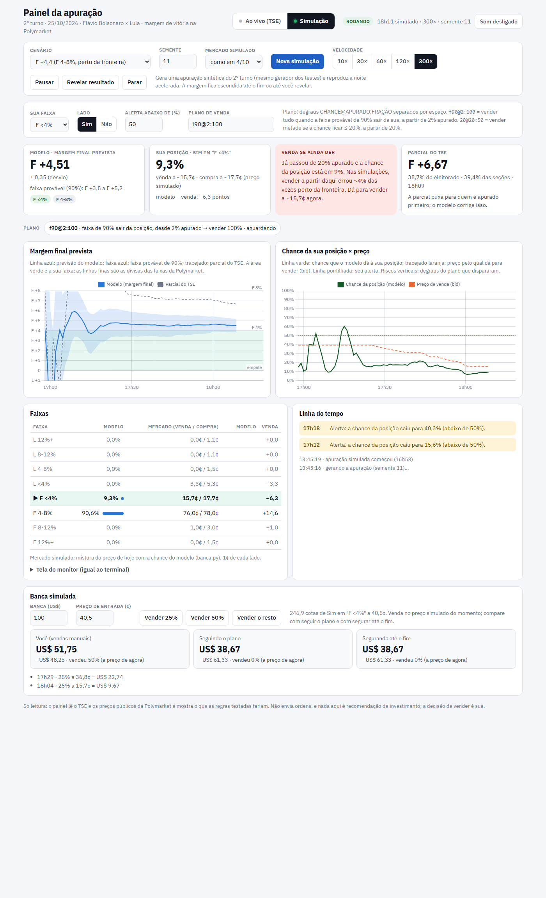

# Margem do 2º turno 2026: risco da posição durante a apuração

Mercado: [Brazil Presidential Election Second Round: Margin of Victory](https://polymarket.com/event/brazil-presidential-election-second-round-margin-of-victory)
(Polymarket). Margem = |%Flávio − %Lula| dos votos válidos; se cair exatamente na fronteira,
vale a faixa de cima. Resolve pelo resultado oficial do TSE.

Só leitura: o monitor consulta os JSON públicos do TSE e os preços públicos da Polymarket. Não
envia ordens. O Brasil é "close-only" na Polymarket: qualquer venda é manual.

## Começo rápido

Os comandos rodam da pasta que contém `eleicao/`. De dentro de `eleicao/`, tire o `eleicao/` do
começo.

```bash
pip install -r eleicao/requirements.txt
```

No dia 25/10, a partir das 16h50: painel no navegador, já lendo o TSE (troque a faixa e o plano
pelos seus):

```bash
python eleicao/painel.py --ao-vivo --faixa "F <4%" --degrau f90@2:100
```

Se o painel cair no meio da apuração, retome a mesma sessão:

```bash
python eleicao/painel.py --retomar ultima
```

Antes do dia, para ensaiar: abra o painel sem `--ao-vivo` e use as abas "Simulação" e "Trade
(simulação)". Detalhes em [Como usar](#como-usar-no-dia-2510); o que cada pasta tem, em
[Estrutura do projeto](#estrutura-do-projeto).

Guia visual (como ler a tela, duas noites simuladas e o modelo contra o mercado):
[Guia da apuração](https://claude.ai/artifact/SvkYDSc7NdFR23Sz2EjnyQ).

**Conteúdo:** [Resumo](#resumo) · [O problema](#o-problema-a-parcial-do-tse-engana) ·
[O modelo](#como-o-modelo-funciona) · [Backtest](#backtest) · [Limitações](#limitações) ·
[Como usar](#como-usar-no-dia-2510) · [Estrutura do projeto](#estrutura-do-projeto)

## Resumo

- **A parcial do TSE engana muito no começo.** Na apuração real do 1º turno de 2026, ela passou
  duas horas mostrando Flávio +10 a +11 na disputa contra Lula. O resultado foi +2,0.
- **O modelo corrige isso com a parcial por município.** Usa o 1º turno de 2026 como base e a
  ordem de chegada das seções. Na apuração real de 2022, às 17h20 (3% apurado), a parcial dava
  Bolsonaro +9,8. O modelo dava −2,1 ± 0,9 (resultado: −1,8) e 92% para a faixa certa.
- **Contra a Polymarket, na noite real do 1º turno, o modelo chegou ~1 hora antes.**
  - Comparação com o mercado de margem do 1º turno (faixas de 5 pontos), com o modelo atrasado
    5 minutos para descontar publicação e download.
  - A faixa vencedora ("Flávio <5%") passou de 80% às 17h21 no modelo e às 18h30 no mercado;
    90%, às 17h46 e às 18h50.
  - Às 17h30 o modelo dava 5% para "Lula <5%", a faixa favorita do mercado (56%), que perdeu.
    Ela ainda era vendida a 50–54¢ naquele minuto e valia ~13¢ às 18h.
- **Mas a margem prevista errou ~2 pontos por volta das 18h** (+3,9 contra +1,9). No mercado do
  1º turno isso não mudou a faixa, porque ela ia de 0 a 5. Com a fronteira de 4 pontos do 2º
  turno, teria apontado a faixa errada por ~30 minutos. Aquele teste era mais difícil que o do
  dia 25 (base de 4 anos antes), mas o risco existe.
- **Quão cedo dá para saber depende de quão perto da fronteira a margem vai cair.** Em 60
  simulações do 2º turno de 2026, a faixa certa passa de 90% (e não cai mais) em:

| Margem final até a fronteira mais próxima | Mediana | Apurado | Já deu ≥80% à faixa errada |
|---|---|---|---|
| mais de 1 ponto | 17h34 | 10% | 0% |
| 0,5 a 1 ponto | 18h04 | 34% | 0% |
| 0,25 a 0,5 ponto | 18h24 | 53% | 18% |
| menos de 0,25 ponto | 19h08 | 85% | 14% |

- **Horários no ritmo do 2º turno de 2022.** O 1º turno de 2026 foi bem mais rápido que o de
  2022: 59% apurado às 19h contra 19%. Se o 2º turno também acelerar, tudo acontece mais cedo.
  O "% apurado" é a referência mais segura.
- **Para quem está em "F <4%" ou "F 4-8%":** a fronteira de 4 pontos fica no meio do que se
  espera. O 1º turno deu Flávio +1,9 e ~8% dos votos foram para outros. Se a margem cair perto
  de 4, o modelo só fica seguro depois de ~metade da apuração.
  - No começo ele tende a puxar para Flávio. Em noites simuladas com o final logo abaixo de 4,
    passou de 65% na faixa errada ("F 4-8%") em mais da metade delas, e de 80% em ~1 em 6.

## O problema: a parcial do TSE engana

A apuração não chega em ordem aleatória. Chegam primeiro os estados pequenos e o Sul, e,
dentro de cada cidade, as seções que fecham antes. Em 2022, a parcial mostrava Bolsonaro
+13 pontos às 17h15. Lula só passou à frente com 67,8% das seções, às 18h45, e venceu por 1,8.



O mesmo viés existe dentro dos municípios. Em 2022, as primeiras seções a chegar eram ~0,8 ponto
mais bolsonaristas que a média da cidade, e as últimas ~0,8 menos. No 1º turno de 2026 a
diferença foi maior: +1,0 e −1,7. É composição (quem vota onde), não mudança de voto: o padrão
já aparecia no 1º turno das mesmas seções.

## Como o modelo funciona

A cada ~40 s, para cada um dos ~5.700 municípios (exterior incluído):

1. **O que já foi apurado:** votos de Flávio e Lula e eleitores das seções totalizadas
   (arquivos do TSE).
2. **Base:** o 1º turno de 2026 no mesmo município, separado por categoria: Flávio, Lula,
   Cury, Renan Santos, Caiado, demais, brancos/nulos e abstenção.
3. **Transferência:** uma regressão, refeita a cada ciclo só com o que já chegou, estima para
   onde vai cada categoria do 1º turno.
   - Inclui efeitos de região e de UF, encolhidos para zero enquanto há poucos dados.
   - Ela prevê a parte que falta de cada município.
   - Um efeito do tamanho do município (cidades pequenas chegam primeiro) foi testado e ficou
     desligado. Ajudou no 1º turno de 2026 com base de 2022, mas nas simulações criava um viés
     falso a favor de Flávio no começo, e no 2º turno real de 2022 não mudava nada.
4. **Ordem de chegada:** com a hora de cada boletim de urna do 1º turno, o modelo sabe quais
   seções costumam chegar primeiro em cada cidade. Assim estima a composição da parte já
   apurada, em vez de supor que ela é a média da cidade.
   - O peso dessa ordem (w) é incerto: a ordem do 2º turno repete a do 1º só em parte
     (correlação ~0,43 dentro do município em 2022).
   - Por isso o modelo mistura hipóteses de w de 0 a 2 (priori 0,65 ± 0,45). Reavalia cada uma
     pelo erro com que previu os votos dos 10 minutos seguintes.
5. **Incerteza:** soma várias fontes, com caudas t (6 g.l.):
   - parâmetros e municípios por apurar;
   - composição da parte apurada e a mistura sobre w;
   - dois termos sistemáticos calibrados nas simulações: 0,3 × fração por apurar, mais até 0,7
     ponto enquanto falta mais de 80%.
6. **Saída:** margem prevista ± incerteza e a probabilidade de cada uma das 8 faixas, ao lado
   do preço da Polymarket.

Em simulação dá para usar a ordem "certa" das seções (oráculo). Com ela, o erro some depois de
~30 min. Quase todo o erro que sobra vem de não saber quais seções já chegaram em cada
município.

## Backtest

### Apurações reais

O BU (boletim de urna) de 2022 e o de 2026 trazem a hora em que cada seção chegou ao TSE
(`DT_BU_RECEBIDO`). Com ela, a apuração é refeita minuto a minuto: a reconstrução de 2022 bate
com a virada real (Lula à frente com 67,8% das seções). 2014 e 2018 não têm essa hora.

**2º turno de 2022** (base: 1º turno de 2022). É o caso igual ao de 25/10.

| Hora | Apurado | Parcial TSE | Modelo | ± 1 dp | Final | P(faixa certa) |
|---|---|---|---|---|---|---|
| 17:10 | 0,7% | +11,2 | −2,31 | 1,69 | −1,80 | 71% |
| 17:15 | 1,5% | +13,0 | −2,80 | 1,28 | −1,80 | 77% |
| 17:20 | 3,0% | +9,8 | −2,11 | 0,93 | −1,80 | 92% |
| 17:30 | 8,0% | +4,8 | −1,82 | 0,72 | −1,80 | 97% |
| 18:00 | 28,3% | +2,2 | −1,80 | 0,56 | −1,80 | 99% |
| 18:30 | 53,6% | +0,4 | −1,53 | 0,23 | −1,80 | 100% |

**1º turno de 2026, Flávio × Lula** (base: 2º turno de 2022; a ordem das seções vem de 2022).
É mais difícil que o caso real: base de 4 anos antes, outra eleição e outra ordem. A margem aqui
é só entre os dois, e a coluna P usa as faixas de 4 pontos do 2º turno.

| Hora | Apurado | Parcial TSE | Modelo | ± 1 dp | Final | P(faixa certa) |
|---|---|---|---|---|---|---|
| 17:30 | 2,4% | +8,2 | +3,29 | 1,14 | +2,02 | 71% |
| 17:45 | 7,0% | +10,7 | +3,99 | 0,79 | +2,02 | 50% |
| 18:00 | 14,4% | +11,4 | +4,26 | 0,59 | +2,02 | 34% |
| 18:30 | 34,4% | +10,2 | +2,56 | 0,46 | +2,02 | 99% |
| 19:00 | 59,2% | +8,3 | +1,78 | 0,23 | +2,02 | 100% |



Aqui o modelo chegou a errar +2,2 pontos às 18h (z ≈ 3,7). O Sudeste mudou de voto menos que as
outras regiões e estava só 2 a 7% apurado. Com faixas de 4 pontos, a faixa certa ("F <4%")
caiu para 34% às 18h antes de voltar a 99% às 18h30. O termo de tamanho do município reduzia
esse erro para ~1,3 ponto, mas foi desligado pelo motivo descrito acima.

### Modelo × Polymarket (noite real do 1º turno)

`coleta/mercado_1t.py` baixa os preços, minuto a minuto, do mercado de margem do 1º turno (faixas de
5 pontos, margem sobre todos os válidos). `estudos/comparar_mercado.py` roda o modelo como se fosse ao
vivo naquela noite. Na tabela, o modelo foi atrasado 5 minutos (publicação do TSE e download)
e o mercado foi normalizado para as faixas somarem 100%. Resultado: Flávio +1,86, faixa
"Flávio <5%".

| Hora | Apurado | Parcial | Modelo (margem) | "Flávio <5%": modelo | mercado | "Lula <5%": modelo | mercado |
|---|---|---|---|---|---|---|---|
| 17:20 | 0,8% | +2,5 | +0,5 ± 1,6 | 61% | 29% | 37% | 56% |
| 17:25 | 1,2% | +6,1 | +1,5 ± 1,4 | 82% | 32% | 16% | 56% |
| 17:30 | 1,7% | +7,0 | +2,3 ± 1,2 | 91% | 34% | 5% | 56% |
| 17:45 | 5,2% | +9,2 | +3,9 ± 0,8 | 89% | 67% | 0% | 28% |
| 18:00 | 11,7% | +10,4 | +4,0 ± 0,6 | 93% | 71% | 0% | 11% |
| 18:30 | 29,5% | +9,6 | +2,8 ± 0,5 | 100% | 81% | 0% | 6% |

- **Quando passou de 80% na faixa vencedora (e não caiu mais):** modelo às 17h21, mercado às
  18h30. De 90%: 17h46 e 18h50.
- **O mercado não seguiu a parcial inflada.** "Flávio 5-10%" nunca passou de ~16%. Mas acreditou
  nas pesquisas (Lula na frente) até ~17h35 e só virou entre 17h35 e 18h.
- **Preços de verdade nos negócios:**
  - "Lula <5%" foi vendida a 50–54¢ entre 17h27 e 17h32, com ~1.400 cotas negociadas; às 18h,
    ~13¢.
  - "Flávio <5%" foi vendida a 34¢ às 17h30 e pagou US$1.
- Depois das 17h30, o modelo nunca deu mais que 11% a uma faixa errada do mercado. A versão
  anterior aos ajustes de parâmetro ("antes") chegou a 90% até mais cedo, às 17h26.
- Ressalva: é uma noite só, e as faixas de 5 pontos perdoam o erro de ~2 pontos na margem.
  Em outro dia o erro pode ir para o lado que muda a faixa.

Um terceiro teste roda ao contrário: o 1º turno de 2022 apurado com o 2º turno como base. Ele é
mal especificado por construção, porque a base não tem os outros candidatos. Errou até 1,6 ponto
entre 5% e 60% apurado. Tabelas em [resultados/tabelas.md](resultados/tabelas.md).

### Simulações

Cada simulação gera um 2º turno inteiro, seção a seção, a partir do 1º turno, e sorteia:

- a margem final;
- a transferência de votos de cada candidato do 1º turno;
- desvios por região, UF, município e seção, entre os tamanhos medidos em 2022 (uniforme) e
  em 2018 (heterogêneo);
- a hora de chegada: a distribuição de horários do 2º turno de 2022 por município, ou o 1º
  turno do mesmo ano no ritmo do 2º. A ordem dentro do município mistura a ordem do 1º turno
  (correlação 0,3–0,6) com sorteio.

Foram 60 simulações sobre o 1º turno de 2026 e 40 sobre o de 2022.

| Apurado | Erro da parcial | Erro do modelo | Incerteza do modelo | Dentro do IC 95% |
|---|---|---|---|---|
| 0–2% | 8,5 | 1,59 | 1,56 | 96% |
| 2–5% | 7,1 | 0,82 | 0,93 | 99% |
| 5–10% | 6,4 | 0,63 | 0,78 | 97% |
| 10–20% | 5,9 | 0,62 | 0,69 | 96% |
| 20–35% | 5,2 | 0,46 | 0,55 | 99% |
| 35–50% | 4,4 | 0,19 | 0,32 | 100% |
| 50–70% | 3,6 | 0,08 | 0,19 | 100% |

(Simulações de 2026; erro = raiz do erro quadrático médio, em pontos.) O erro médio com sinal
é +0,6 ponto (a favor de Flávio) com menos de 2% apurado, +0,3 entre 2% e 5% e perto de zero
depois de 5%.

Quando o modelo diz 50%, a faixa sai em 50% dos casos. Acima disso ele é conservador: quando
diz 68%, sai em 74%; quando diz 83%, em 94%; quando diz 95%, em quase 100%.



### Regras de venda (`estudos/estrategia.py`)

Como o Brasil é close-only, a única decisão é segurar ou vender. Testei regras de venda em 47
noites simuladas com a margem final a menos de 1 ponto de 4: 7 do lote geral e 40 de um lote só
entre 3 e 5. Cada noite conta duas vezes, para "F <4%" e para "F 4-8%" (94 casos). Também
testei em 53 noites longe de 4 (106 casos) e na noite real do 1º turno, com os preços reais.
Tabelas completas em [resultados/estrategia.md](resultados/estrategia.md).

| Regra | Perto de 4: vendeu por engano | Perto de 4: 1ª venda | Longe de 4: 1ª venda | Noite real, "Lula <5%": valor por cota |
|---|---|---|---|---|
| **Tudo quando a faixa de 90% sai da sua** (desde 2%) | 2% | 18h33 | 17h21 | US$ 0,51 |
| Metade quando a faixa de 90% sai + resto se chance ≤ 20% (desde 20%) | 4% | 18h03 | 17h21 | US$ 0,32 |
| Tudo se chance ≤ 20%, desde 20% apurado | 4% | 18h03 | 17h55 | US$ 0,13 |
| Tudo se chance ≤ 20%, desde 5% apurado | 9% | 17h41 | 17h31 | US$ 0,28 |
| Escalonada: ⅓ a 30%, ⅓ a 15%, ⅓ a 5% (desde 5%) | 17% | 17h31 | 17h31 | US$ 0,28 |

"Vendeu por engano" conta as noites em que a faixa ia ganhar e a regra vendeu ao menos parte.
Em todas as regras, quando a faixa perdia, a venda acabava acontecendo; a diferença é a hora e o
preço. Na noite real, nenhuma regra vendeu "Flávio <5%", que ganhou.

A primeira regra foi a mais equilibrada porque se adapta sozinha. Com o resultado claro, a faixa
provável sai cedo da sua faixa; colado em 4, ela continua cobrindo as duas e a regra espera.
Vender pela chance sozinha antecipa a venda, mas tira mais posições vencedoras. Estes são
resultados de teste, não recomendação de investimento: não sou consultor financeiro licenciado,
e a decisão e o tamanho da posição são seus.

### Em dinheiro: banca de US$100 (`estudos/banca.py`)

Exemplo: US$100 em "F <4%" a 41¢ compram 244 cotas, e cada cota paga US$1 se a faixa ganhar.
Segurando até o fim, você termina com US$244 ou US$0. Com uma regra de venda, quando ela
dispara, você recebe o preço daquele momento por cota.

Nas noites simuladas não há preço de mercado, então ele foi modelado:
`preço = (1 − λ) × preço de hoje + λ × chance do modelo`, com λ subindo de 0 a 1 ao longo da
noite. "Lento" imita a noite real do 1º turno (o mercado tinha andado ~60% do caminho às 17h45
e ~90% às 19h). A venda sai 1¢ abaixo do preço. As médias ponderam os cenários pelas chances
que o próprio mercado dá hoje.

Média, com US$100 comprados ao preço de hoje (F <4% a 41¢, F 4-8% a 33¢):

| Mercado na noite | Posição | Segurar | Faixa de 90% sai da sua | Chance ≤ 20% (desde 5%) | Escalonada | Stop no preço (< 15¢) |
|---|---|---|---|---|---|---|
| Lento (como 4/10) | F <4% | US$ 94 | US$ 136 | US$ 150 | US$ 142 | US$ 114 |
| Mais esperto | F <4% | US$ 94 | US$ 113 | US$ 115 | US$ 110 | US$ 113 |
| Igual ao modelo | F <4% | US$ 94 | US$ 96 | US$ 103 | US$ 100 | US$ 96 |
| Lento (como 4/10) | F 4-8% | US$ 94 | US$ 148 | US$ 153 | US$ 151 | US$ 122 |
| Mais esperto | F 4-8% | US$ 94 | US$ 120 | US$ 115 | US$ 113 | US$ 121 |
| Igual ao modelo | F 4-8% | US$ 94 | US$ 97 | US$ 101 | US$ 100 | US$ 106 |

- Segurar dá menos que US$100 porque o preço de compra fica um pouco acima da chance que o
  próprio mercado dá.
- Quase todo o ganho das regras vem de vender cedo uma faixa que vai perder, antes de o preço
  cair. Por isso depende da velocidade do mercado: se ele souber tudo o que o modelo sabe,
  nenhuma regra ganha de segurar por muito.
- As regras que vendem pela chance (≤ 20% desde 5%, escalonada) têm média parecida ou um pouco
  maior que a da faixa de 90%, mas vendem mais vezes a faixa que ia ganhar (9–17% contra 2%
  perto de 4).
- Por cenário: [resultados/banca.md](resultados/banca.md). A calculadora do guia aceita outra
  banca e outro preço de compra.

Noite real do 1º turno, US$100 comprados às 17h a preço real:

- "Lula <5%" (perdeu), a 54,5¢: segurar dava US$0. A faixa de 90% vendia às 17h33 a 50¢ e
  devolvia US$93; chance ≤ 20% desde 5%, US$52; desde 20%, US$24.
- "Flávio <5%" (ganhou), a 29¢: nenhuma regra vendeu, e a banca virou US$342.

### Duas perguntas sobre o mercado e o modelo

**O mercado corre atrás da parcial inflada no começo?** Na noite real do 1º turno, não. Entre
17h25 e 17h55, a parcial mostrava Flávio +6 a +10, e mesmo assim "Flávio 5-10%" ficou em 4–5¢
e "Flávio 10%+" em ~0,1¢. O único pico ("F 5-10%" a 15,6¢ às 18h, por poucos minutos) veio
quando o mercado percebeu que Flávio estava à frente, não por causa da parcial. Os traders
parecem conhecer o efeito de 2022. É uma noite só, e no 2º turno a dúvida é o tamanho da margem,
não quem lidera.

**Quando o modelo diz "quase certeza", acerta?** Nas simulações de 2026, a partir de 2% apurado:

| Sinal | Perto de 4: acertou | Perto de 4: hora (mediana) | Longe de 4: acertou | Longe de 4: hora |
|---|---|---|---|---|
| Chance da faixa ≥ 90% | 96% | 18h21 | 100% | 17h30 |
| Faixa de 90% inteira dentro da faixa | 98% | 18h32 | 100% | 18h04 |
| Chance da faixa ≥ 97% | 100% | 18h47 | 100% | 18h11 |

Na noite real do 1º turno, "Flávio <5%" passou de 90% no modelo às 17h30 e ainda negociava a
34¢; terminou valendo US$1. Comprar não é possível do Brasil (close-only). O que dá para usar é
o inverso: não vender a própria faixa barato quando o mercado a desvaloriza e o modelo dá
≥ 90% a ela.

## Limitações

- **Só uma apuração real de 2º turno com hora de chegada (2022), e o modelo foi desenhado
  olhando para ela.** A ordem do 1º turno, a variância de composição e a priori de w são
  escolhas feitas dentro da amostra. Os testes de fora dela são:
  - o 1º turno de 2026 e o 1º turno de 2022 ao contrário (ambos mais difíceis que o caso
    real);
  - as simulações, que carregam as premissas do gerador;
  - os 2ºs turnos de prefeito de 2024 (51 cidades, só a ordem de chegada): w médio de
    0,65 ± 0,10, com dispersão de 0,44 entre cidades, igual à priori. O ruído de composição
    é ~7 vezes maior que o modelo supõe, porque os locais de votação chegam inteiros; no
    backtest nacional isso só pesa antes de ~2% apurado. Ver
    [resultados/validacao_2024.md](resultados/validacao_2024.md).

  O teste honesto é a noite de 25/10. `calibracao.json` congela os parâmetros.
- **O modelo pode ficar confiante e errado por ~1 ponto** se uma região grande mudar de voto
  diferente e chegar tarde, como o Sudeste no 1º turno de 2026. Antes de ~35% apurado, não
  trate 90% como certeza perto de uma fronteira.
- **TSE:**
  - os arquivos do 2º turno ainda são de teste: hoje TO não existe e vários municípios vêm
    com eleitorado zero. Por isso o eleitorado vem do 1º turno, que é o mesmo cadastro;
  - em 25/10 a estrutura dos arquivos pode mudar. Rode o pré-voo antes das 17h.
- **Liquidez:** o modelo compara com o bid e o ask da hora, mas o livro some quando a apuração
  anda. A venda só sai ao preço que houver.
- Recontagem, urnas anuladas e erros do TSE ficam fora do modelo.

## Como usar no dia 25/10

```bash
pip install -r eleicao/requirements.txt
```

Dados (uma vez). O BU do 1º turno de 2026 tem ~5 GB, e a CDN do TSE limita a velocidade quando
há muitas conexões:

```bash
python eleicao/coleta/baixar_bu.py --ano 2026 --turno 1 --workers 2
```

### Painel no navegador

O mesmo monitor, com gráficos, avisos sonoros e um modo de simulação. Abre em
http://127.0.0.1:8050 (só no seu computador):

```bash
python eleicao/painel.py --faixa "F <4%" --degrau f90@2:100
```



- **Ao vivo (TSE).** O botão "Começar a ler o TSE" liga o monitor: a cada 40 s, com os preços da
  Polymarket. No dia 25, `--ao-vivo` já abre lendo. Antes disso, um clique serve de pré-voo:
  mostra "sem votos apurados ainda" e os preços do momento.
- **Simulação.** Gera um 2º turno sintético de 2026 (o mesmo gerador dos testes) e reproduz a
  noite acelerada, de 10× a 300×.
  - Cenário "às cegas": a margem é sorteada pelas chances que o mercado dá hoje. Os outros fixam
    a margem (perto da fronteira de 4, folgada ou Lula vencendo).
  - A margem fica escondida até o fim ou até "Revelar resultado". Dá para pausar.
  - Banca simulada: venda 25%, 50% ou o resto no preço do momento. No fim, compara suas vendas,
    o plano e segurar até o fim.
  - O preço da simulação vem de `nucleo/mercado_sim.py`: vai do preço de hoje à chance do modelo, no ritmo
    escolhido ("como em 4/10", "mais esperto" ou "igual ao modelo", o pior caso para quem usa o
    modelo). Não é uma previsão do mercado.
- **Sua posição** (faixa, Sim/Não, alerta e plano) muda na hora, vale para as duas abas e fica
  salva no navegador.
- **Na tela:**
  - margem prevista com a faixa de 90% e a sua faixa marcada;
  - chance da posição × preço de venda;
  - o que a regra testada diz naquele momento;
  - a parcial do TSE;
  - os degraus do plano;
  - as faixas, modelo × mercado;
  - a linha do tempo com degraus disparados, alertas e mudanças da faixa provável;
  - em "Tela do monitor", o mesmo texto do terminal.
- **Som:** ligue o botão "Som" (o navegador só toca depois de um clique). Toca quando um degrau
  dispara, quando a chance cai abaixo do alerta e quando a faixa de 90% sai da sua. A aba ao vivo
  continua sendo lida enquanto você usa a simulação, então os avisos tocam do mesmo jeito.
- **Se o painel cair ou for fechado no meio da apuração, retome a sessão**, em vez de começar do
  zero:

  ```bash
  python eleicao/painel.py --retomar ultima
  ```

  - Os ciclos gravados voltam aos gráficos e à linha do tempo. O modelo é refeito passando os
    retratos da sessão, em ordem, o que devolve o histórico com que ele julga a ordem de chegada
    (w). Leva ~0,1 s por ciclo gravado (~30 s lá pelas 20h).
  - Depois o painel segue lendo o TSE e gravando na mesma pasta. Os municípios que mudaram
    durante a queda são baixados primeiro, até 450 por ciclo.
  - Num ensaio com queda de ~5 min (17h41 → 17h46), o 1º ciclo retomado deu F +4,53 ± 0,78
    (w 0,55), e um monitor que não parou deu F +4,60 ± 0,74 (w 0,51); o final foi F +4,27.
    Começar do zero perde o w aprendido (volta à priori, 0,69), e o 1º ciclo baixa todos os
    ~5.700 municípios: ~6 min no TSE de verdade até a primeira previsão.
  - `ultima` = a sessão mais recente em `dados/ao_vivo/`, das últimas 12 h, que leu a mesma
    `--url` e tem dados. Ensaios contra o replay local e pré-voos de outros dias não entram no
    lugar da noite real. Se não houver nada para retomar, começa uma sessão nova (`--retomar` já
    abre lendo o TSE, como `--ao-vivo`). Também aceita o nome da pasta:
    `--retomar 20261025_165012`.
  - Sem `--retomar`, a aba ao vivo mostra o botão "Retomar <sessão>" quando há uma sessão
    gravada.
  - A página que ficou aberta se reconecta sozinha. Degraus e alertas de antes da queda não tocam
    de novo, e o gráfico fica interrompido no trecho sem ciclos.
  - Retome logo. Com até ~10 min de queda, o modelo retomado ficou perto de quem não parou.
    Com 20–40 min, o 1º ciclo julga w de uma vez por tudo o que chegou durante a queda. Numa
    de duas noites simuladas, w pulou de 0,4–0,6 para 0,85–1,1, e a margem ficou 0,5–0,7 ponto
    abaixo da corrida sem queda (ainda dentro da incerteza mostrada).
  - Uma sessão só abre em um lugar por vez. Se o painel e o monitor do terminal tentarem a mesma
    pasta, o segundo para com um aviso.

### Aba "Trade (simulação)"

A mesma noite simulada da aba Simulação, agora com uma carteira que troca de faixa quando o modelo
aponta outra. Os controles da noite são os mesmos (cenário, velocidade, pausa, revelar). Só
simulação: nada aqui envia ordens.

- **Regra** (editável na aba): a partir de 2% apurado, se a faixa favorita do modelo não é a da
  carteira e tem pelo menos 70%, vende tudo no preço de venda. Depois compra a favorita no preço de
  compra se a chance do modelo passar o preço por 5 pontos ou mais; senão espera em dinheiro e
  compra quando a vantagem aparecer. Máximo de 2 trocas por noite.
- **Na tela**, como no ao vivo:
  - a carteira (faixa atual e valor no preço de venda);
  - o que a regra está fazendo naquele momento;
  - a margem com a faixa da carteira marcada;
  - o valor da carteira contra segurar a posição inicial, com as trocas marcadas;
  - a linha do tempo com cada compra e venda (com som).
- **Botões:**
  - "Trocar agora para a favorita";
  - "Vender tudo (ficar em dinheiro)", que também desliga o automático;
  - o interruptor do automático.

  Tudo vale do ciclo do clique em diante.
- **"Testar esta regra nas 100 noites simuladas salvas"** roda só a regra automática nas noites de
  `estudos/banca.py`, nos três ritmos de mercado. É o mesmo cálculo de `python eleicao/estudos/trade.py`.

Com a regra padrão, começando em Sim "F <4%" a 40,5¢ com US$100. Cada noite pesa pela chance que
o mercado dá hoje ao cenário dela:

| Ritmo do mercado | Com trocas: média | Mediana | 10% piores ficam abaixo de | Noites com prejuízo | Perdem mais da metade | Segurar: média |
|---|---|---|---|---|---|---|
| como em 4/10 | US$ 344 | US$ 291 | US$ 158 | 7% | 2% | US$ 95 |
| mais esperto | US$ 151 | US$ 134 | US$ 48 | 34% | 11% | US$ 95 |
| igual ao modelo | US$ 104 | US$ 61 | US$ 0 | 65% | 46% | US$ 95 |

**Esses lucros vêm quase todos de uma premissa.** O preço simulado é feito a partir do próprio
modelo: o mercado vai até a chance que o modelo dá, com atraso. Ele nunca sabe algo que o modelo
não sabe nem se mexe antes dele. O teste mede quanto vale esse atraso, não se o modelo acerta.

- Se o mercado reagir tão rápido quanto o modelo, trocar perde dinheiro em 2 de cada 3 noites. A
  média de US$ 104 se sustenta em poucas noites com ganho enorme: faixas compradas a 5–10¢ que
  pagam US$ 1.
- As noites simuladas vêm de um gerador parecido com o modelo, então ele acerta mais nelas do que
  na vida real. Na noite real do 1º turno, a margem prevista errou ~2 pontos às 18h. Com faixas de
  4 pontos, a faixa certa teria caído para 34%: perto de a regra trocar para a errada.
- Numa noite real, a liquidez para comprar uma faixa que está subindo pode ser bem menor que a
  simulada.

**Na noite real do 1º turno (4/10), com os preços de verdade da Polymarket,** o atraso existiu.
Começando em "Lula <5%" (a favorita do mercado antes da apuração), a regra vendia a 50¢ às 17h33 e
comprava "Flávio <5%" a 40¢: US$ 100 viravam ~US$ 209 (US$ 191 com 3¢ de cada lado), contra zero
de quem segurou. Às 17h40 passavam US$ 50–220 por minuto nessa faixa, o bastante para US$ 100.
Mas é uma noite só, e o ritmo "como em 4/10" saiu justamente dela. A aba Trade mostra essas
tabelas para a regra que estiver na tela.

Para planejar, o "mais esperto" é o cenário mais razoável e "como em 4/10" é o teto. Na noite, a
coluna "Modelo − venda" do painel, nos primeiros 20–30 min, mostra se o mercado está andando atrás
do modelo.

### No terminal

Ensaio de ponta a ponta com um 2º turno sintético de 2026 (margem +4,3), acelerado 40×
(17h–21h em 6 minutos):

```bash
python eleicao/nucleo/replay_tse.py --sintetico --ano-base 2026 --margem 4.3 --velocidade 40 --inicio -5
```

```bash
python eleicao/monitor.py --url http://127.0.0.1:8765 --faixa "F 4-8%" --intervalo 6
```

Para ensaiar uma queda, feche o monitor (Ctrl+C) no meio e rode de novo com `--retomar ultima`
(com a mesma `--url`).

Pré-voo contra o TSE de verdade (antes das 17h mostra "sem votos apurados ainda"):

```bash
python eleicao/monitor.py --ciclos 1
```

Ao vivo (a partir das 17h; troque a faixa e o lado pela sua posição):

```bash
python eleicao/monitor.py --faixa "F <4%" --lado sim --polymarket
```

Se o monitor cair ou o terminal fechar, rode o mesmo comando com `--retomar ultima` (vale o que
foi dito para o painel):

```bash
python eleicao/monitor.py --faixa "F <4%" --lado sim --polymarket --retomar ultima
```

Ele refaz o modelo com os retratos gravados, resume o último ciclo de antes da queda e segue na
mesma pasta. Os degraus do plano que já tinham disparado aparecem como "já tinha disparado" e
não disparam de novo.

A cada ciclo aparece:

- a parcial do TSE;
- a margem prevista ± 1 desvio;
- a **faixa provável**: onde o resultado cai com 90% de chance e quais faixas ela toca. Ex.:
  `faixa provável (90%): F +3.55 a F +6.77 -> cobre F <4%, F 4-8%`;
- a probabilidade de cada faixa e, com `--polymarket`, o bid/ask;
- a linha da posição, com a chance de ela pagar e o preço de venda.

Plano de venda pré-definido (o monitor só avisa, não vende). Cada `--degrau` é
`CHANCE@APURADO:FRAÇÃO`, e `f90` no lugar da chance quer dizer "quando a faixa de 90% sair da
sua":

```bash
python eleicao/monitor.py --faixa "F <4%" --polymarket --degrau f90@2:100
```

Avisos:

- `>>> PLANO` (com bipe) quando um degrau dispara;
- `!!` quando o modelo dá à posição menos que o preço pelo qual dá para vendê-la;
- `!!!` (com bipe) quando a chance cai abaixo de `--alerta` (padrão 50%), a partir de 1%
  apurado.

Tudo fica gravado em `eleicao/dados/ao_vivo/<sessão>/`: o log por ciclo, os retratos por
município e `sessao.json` (URL e base, conferidas ao retomar). Com isso dá para refazer a noite
depois e retomar a sessão.

Limites do TSE: cada arquivo leva ~1 s e o servidor aceita ~15 por segundo por cliente; mais
conexões pioram. O monitor baixa até 450 municípios por ciclo, os mais atrasados primeiro. No
replay de 2022, até 300 por minuto deixaram o modelo praticamente igual.

## Estrutura do projeto

```
eleicao/
├── painel.py, painel.html   painel no navegador (ao vivo, simulação e trade) — o que se usa no dia 25
├── monitor.py               o mesmo monitor no terminal; a classe Monitor que o painel usa
├── calibracao.json          parâmetros do modelo congelados (não mexer sem novo backtest)
├── requirements.txt
├── nucleo/                  a base que todo o resto importa
│   ├── caminhos.py          onde ficam dados/, resultados/ e a calibração
│   ├── dados_eleicao.py     padroniza seções e municípios (F = candidato de direita, L = PT)
│   ├── apuracao.py          reconstrói a apuração minuto a minuto, por município
│   ├── modelo.py            o modelo (transferência + ordem de chegada + incerteza)
│   ├── simulacao.py         gera 2ºs turnos sintéticos seção a seção, com horários
│   ├── fonte_tse.py         lê os JSON públicos do TSE
│   ├── replay_tse.py        servidor local que imita o TSE, para ensaiar
│   └── mercado_sim.py       preço de mercado das noites simuladas (preço de hoje → modelo)
├── coleta/                  baixa os dados públicos
│   ├── baixar_bu.py         boletins de urna, com hora de chegada (--cargo 11 = prefeito)
│   ├── baixar_secao.py      votação por seção (Presidente, todos os anos)
│   └── mercado_1t.py        preços da Polymarket na noite do 1º turno
├── estudos/                 testes do modelo e das regras; cada um grava em resultados/
│   ├── backtest.py          o modelo em apurações reais (hora do BU) e sorteadas
│   ├── relatorio.py         gráficos e tabelas do backtest (real e simulado) para este README
│   ├── rodar_simulacoes.py  lotes de noites simuladas
│   ├── validar_2024.py      ordem de chegada (w) nos 2ºs turnos de prefeito de 2024
│   ├── comparar_mercado.py  modelo × Polymarket na noite do 1º turno
│   ├── estrategia.py        regras de venda nas simulações e na noite real
│   ├── banca.py             quanto sobra de US$100 com cada regra
│   └── trade.py             carteira que troca de faixa (a aba Trade do painel)
├── guia/                    guia visual publicado (guia_dados.py → guia_pagina.py)
├── dados/                   dados baixados (fora do git, menos ao_vivo/ e polymarket_1t)
│   └── ao_vivo/             cada sessão do monitor/painel: log, retratos e sessao.json
└── resultados/              tabelas, gráficos e dados que os estudos geram
```

Os scripts de `coleta/`, `estudos/` e `guia/` rodam direto (`python eleicao/estudos/banca.py`) e
acham a raiz do projeto sozinhos. Em `resultados/`, o prefixo diz quem gerou: `real_*` e
`tabelas.md` (relatorio), `sim_*` (rodar_simulacoes), `mercado_1t_*` (comparar_mercado),
`estrategia*` (estrategia), `banca*` (banca), `validacao_2024*` (validar_2024) e `guia_*` (guia).
