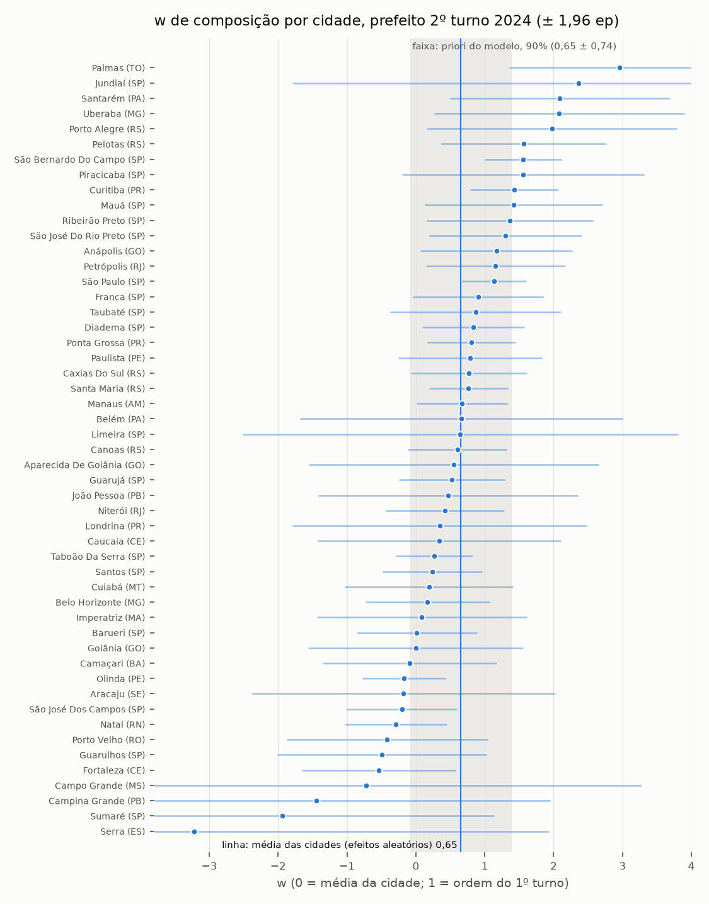

# Validação do peso da ordem (w) nos 2ºs turnos de prefeito de 2024

14/10/2026. Script: [`validar_2024.py`](../validar_2024.py). Tabelas completas também em
[validacao_2024_tabelas.md](validacao_2024_tabelas.md) e linha a linha em
[validacao_2024.csv](validacao_2024.csv).

O modelo supõe que a parte já apurada de cada município tem a composição
`média + w × (primeiras seções pela ordem do 1º turno − média)`. A priori de w
(0,65 ± 0,45, grade de 0 a 2) veio quase só do 2º turno de 2022. Aqui, cada cidade com 2º turno
de prefeito em 2024 vira um teste independente, com o mesmo sistema de transmissão do TSE.

## Resumo

- **A priori confere.** Nas 51 cidades, a média de w é 0,65 ± 0,10 e a dispersão verdadeira
  entre cidades é 0,44 (efeitos aleatórios, já descontado o ruído de cada cidade). A priori é
  0,65 ± 0,45. Outras medidas dão 0,53 a 0,75 (tabelas no fim). Considerado o ruído de cada
  cidade, 96% delas caem no intervalo de 90% da priori. Em 2022 o melhor w ficou entre 0,5 e 1,0.
- **A ordem do 1º turno reduz o erro em ~⅓, mas não em toda cidade.** Com w = 0,65, o erro da
  projeção da margem final da cidade cai, em relação à parcial (w = 0):

  | Seções apuradas | Parcial (w = 0) | w = 0,65 | Redução |
  |---|---|---|---|
  | 10% | 5,4 | 4,4 | 18% |
  | 25% | 3,2 | 2,1 | 34% |
  | 50% | 2,5 | 1,6 | 34% |
  | 75% | 1,4 | 1,0 | 31% |

  (Raiz do erro quadrático médio entre as 51 cidades, em pontos de margem.)
  - O viés real da parte apurada tem o sinal previsto pela ordem do 1º turno em ~70% das
    cidades.
  - w = 0,65 erra menos que a parcial em ~60% das cidades. A 25% apurado, melhora mais de
    1 ponto em 15 cidades e piora mais de 1 ponto em 6.
  - Onde piora, a ordem do 1º turno previa um viés forte que o 2º turno não repetiu. Em Olinda
    e Canoas, com 25% apurado, a ordem previa +10,5 e +10,7 pontos; o real foi +1,3 e +3,9.
  - Usar o w ajustado nas outras 50 cidades (0,56 a 0,68) dá o mesmo erro que 0,65.
- **Quase todo o erro é saber quais seções já chegaram.** Com a composição real da parte
  apurada, o erro cairia para 0,7, 0,6, 0,4 e 0,2 ponto. A ordem do 1º turno recupera só
  20 a 40% do erro de composição. O resto se comporta como ruído.
- **Achado lateral: o ruído de composição é ~7 vezes maior (em variância) que o modelo supõe.**
  - `Ordem1T.var_composicao` trata as seções como sorteadas uma a uma. Na prática chegam
    locais de votação inteiros (~9 seções, quase com a mesma composição).
  - Medido com locais, o ruído bate: z² ≈ 1,3–2,0, e o excesso é compatível com a variação
    de w entre cidades. Medido com seções, z² ≈ 11–18.
  - No backtest nacional, multiplicar esse termo por 8 (`kappa_comp` = 8) muda a previsão em
    até ~1 ponto só nos primeiros 15–20 minutos (menos de 1,5% apurado). Depois de 2–3%
    apurado, muda menos de 0,3 ponto. O resultado não melhora de forma consistente.
- **Recomendação: não mudar `calibracao.json`.**
  - Média e largura de w: a priori 0,65 ± 0,45 e a grade de 0 a 2 estão certas para o que 2024
    mostrou. Os 33% de cidades com w fora de 0–2 são quase todos ruído: com a dispersão
    verdadeira de 0,44, só ~7% das cidades teriam w abaixo de 0. O w do modelo é um só para o
    país, uma média de milhares de municípios, então a priori ainda é folgada.
  - `kappa_comp`: a evidência de 2024 é clara sobre o ruído por local, mas o efeito no
    modelo nacional é pequeno e ambíguo nos dois backtests reais. Fica como teste para
    depois de 25/10, com simulações que sorteiem a chegada por local, não por seção.
  - Para o dia: até 2–3% apurado, a composição da parte apurada de cada município é mais
    incerta do que o modelo diz. Isso reforça a cautela que o README já pede antes de ~35%
    apurado.



## O que foi medido

- **Dados.** Boletins de urna de prefeito de 2024, 1º e 2º turno, das 20 UFs com 2º turno
  (51 cidades). A hora de chegada (`DT_BU_RECEBIDO`) está em 100% das seções.
  - No 2º turno: 97.392 seções, 10.532 locais de votação e 34,0 milhões de eleitores.
  - Todas as seções do 2º turno foram casadas com as do 1º por zona e seção.
- **Apuração do 2º turno.** `apuracao.apurar` refeita no instante em que 10, 25, 50 e 75% das
  seções de cada cidade tinham chegado.
- **Base do 1º turno.** As mesmas categorias do modelo:
  - F (o finalista mais votado no 1º turno) e L (o outro);
  - cada outro candidato com pelo menos 1% dos válidos, e os demais juntos;
  - brancos + nulos e abstenção.

  A composição pela ordem do 1º turno sai de `modelo.Ordem1T`, o mesmo código do monitor.
- **Composição real.** Os votos do 1º turno exatamente das seções que já tinham chegado no 2º
  turno.
- **Margem implícita.** Para comparar composições num número só, cada uma vira a margem do
  2º turno que ela implica.
  - A transferência do 1º para o 2º turno vem de uma regressão por seção, dentro da cidade,
    com o resultado final. É um oráculo, para separar o efeito de w do da transferência.
  - Conferência sem regressão: só o duelo F × L do 1º turno. Dá w parecido (0,72 ± 0,09).
- **w_comp.** O w que faz a margem implícita prevista da parte apurada bater com a real. Por
  cidade, é um ajuste único sobre os 4 pontos.
- **Projeção e w_proj.** A parte que falta vota como a apurada, por eleitor, mais a diferença
  de composição prevista entre as duas (vezes w). Com w = 0, isso é a própria parcial.
  - É o cálculo do modelo para um município com psi = 1 e transferência conhecida.
  - w_proj é o w que acerta a margem final da cidade. Fica quase igual a w_comp, porque com a
    composição real o erro some.
- **Ruído.** O erro-padrão de w de cada cidade é o que se teria se os locais de votação
  chegassem em ordem aleatória. A variação de w entre cidades, descontado esse ruído, sai por
  efeitos aleatórios (DerSimonian-Laird).

A correlação de ordem entre os turnos dentro da cidade (Spearman, por seção) teve mediana
0,54, de −0,09 a 0,84. Em 2022 foi ~0,43.

## Limitações

- **Prefeito não é presidente.**
  - As 51 cidades têm todas mais de 200 mil eleitores.
  - O 1º turno municipal teve dois votos por eleitor e apuração lenta: em BH, metade das
    seções chegou às 19h04 no 1º turno e às 18h07 no 2º.
  - O que se transfere entre os turnos é a logística de cada local (fila, transmissão), que é
    a mesma em 2026.
- **Transferência oráculo e psi = 1.** O teste mede só a composição. No modelo, a
  transferência vem da regressão entre municípios e só 80% do resíduo de cada município passa
  para a parte que falta.
- **w por cidade** é ajustado em 4 pontos aninhados. Nas cidades pequenas, o erro-padrão
  passa de 1.
- **Uma eleição.** 2024 e 2022 concordam (w perto de 0,65–0,75), mas são só duas apurações.

## Como refazer

Dados (uma vez; o 1º turno tem ~2,5 GB e levou ~50 min com 2 conexões):

```bash
python eleicao/baixar_bu.py --ano 2024 --turno 2 --cargo 11 --ufs AM,BA,CE,ES,GO,MA,MG,MS,MT,PA,PB,PE,PR,RJ,RN,RO,RS,SE,SP,TO --workers 2
```

```bash
python eleicao/baixar_bu.py --ano 2024 --turno 1 --cargo 11 --ufs AM,BA,CE,ES,GO,MA,MG,MS,MT,PA,PB,PE,PR,RJ,RN,RO,RS,SE,SP,TO --workers 2
```

Se uma conexão travar (o arquivo do RS ficou a ~10 KB/s), interrompa e rode de novo: o
download continua de onde parou e as UFs prontas são puladas.

```bash
python eleicao/validar_2024.py
```

## Tabelas

Margens em pontos dos votos válidos, F − L. "Viés" é o desvio da margem implícita da parte
apurada em relação à da cidade inteira. Na tabela por cidade:

- **1T F−L:** margem entre os dois finalistas no 1º turno.
- **ρ ordem:** correlação entre a ordem de chegada das seções no 1º e no 2º turno.
- **viés a 25%:** com 25% das seções, o viés previsto pela ordem do 1º turno (w = 1) e o real.
- **erros:** raiz do erro quadrático médio da projeção nos 4 pontos.
  - "w agrup." usa o w das outras 50 cidades.
  - "w cidade" usa o w ajustado na própria cidade, o melhor possível com um w só.
  - "comp. real" usa a composição real da parte apurada.

### Erro da projeção da margem final da cidade (RMS entre as 51 cidades, pontos)

| seções apuradas | eleitores apurados (mediana) | viés real com o sinal previsto | w_comp agrupado | w_proj agrupado | erro parcial (w=0) | w=0,65 | w agrupado (sem a cidade) | w da cidade | composição real | w=0,65 erra menos que w=0 |
|---|---|---|---|---|---|---|---|---|---|---|
| 10% | 10% | 69% | 0,51 | 0,56 | 5,36 | 4,37 | 4,51 | 2,16 | 0,73 | 63% |
| 25% | 25% | 73% | 0,57 | 0,58 | 3,17 | 2,08 | 2,12 | 1,50 | 0,55 | 59% |
| 50% | 50% | 73% | 0,74 | 0,78 | 2,47 | 1,62 | 1,63 | 1,64 | 0,35 | 63% |
| 75% | 75% | 69% | 0,64 | 0,70 | 1,40 | 0,96 | 0,96 | 1,11 | 0,21 | 59% |

Correlação de ordem 1T × 2T dentro da cidade (Spearman, seções): mediana 0,54, de −0,09 a 0,84.

### w por cidade: distribuição e cobertura da priori

| medida | agrupado | média pesada (votos × viés) | p10 / p25 / mediana / p75 / p90 | efeitos aleatórios: média ± ep | dispersão verdadeira (tau) | dentro de −0,09 a 1,39 | dentro da grade 0–2 | nos 90% da priori, com o ruído |
|---|---|---|---|---|---|---|---|---|
| w_comp (composição) | 0,56 | 0,74 | −0,49 / 0,01 / 0,60 / 1,16 / 1,57 | 0,65 ± 0,10 | 0,44 | 57% | 67% | 96% |
| w_comp só com F1 × L1 do 1T (sem b) | 0,53 | 0,75 | −0,05 / 0,23 / 0,68 / 1,08 / 1,80 | 0,72 ± 0,09 | 0,32 | 75% | 82% | 96% |
| w_proj (projeção) | 0,60 | 0,73 | −0,70 / −0,14 / 0,52 / 1,19 / 1,86 | 0,63 ± 0,11 | 0,41 | 55% | 65% | 92% |

### Ruído de composição da parte apurada (w = 0,65 em todas as cidades; z² ≈ 1 se o ruído suposto for o certo)

| seções apuradas | dp do viés real − w·previsto (mediana, pontos) | dp do modelo, seções sorteadas (mediana) | dp com locais sorteados (mediana) | z² médio, seções | z² médio, locais |
|---|---|---|---|---|---|
| 10% | 1,63 | 0,97 | 2,67 | 12,1 | 1,5 |
| 25% | 1,09 | 0,55 | 1,49 | 11,1 | 1,3 |
| 50% | 0,67 | 0,33 | 0,85 | 18,1 | 2,0 |
| 75% | 0,36 | 0,19 | 0,49 | 13,7 | 1,7 |

### Por cidade (erros: RMS da projeção em 10/25/50/75% das seções, pontos)

| cidade | eleitores (mil) | F × L | 1T F−L | 2T final | ρ ordem 1T×2T | viés a 25%: 1T / real | w_comp ± ep | w_proj ± ep | erro w=0 | w=0,65 | w agrup. | w cidade | comp. real |
|---|---|---|---|---|---|---|---|---|---|---|---|---|---|
| São Paulo (SP) | 9322 | MDB × PSOL | +0,7 | +18,7 | 0,64 | +1,22 / +2,71 | +1,14 ± 0,24 | +1,17 ± 0,26 | 2,75 | 1,57 | 1,66 | 1,10 | 0,06 |
| Belo Horizonte (MG) | 1993 | PL × PSD | +12,9 | −7,5 | 0,34 | +1,27 / +0,73 | +0,17 ± 0,46 | +0,15 ± 0,52 | 0,42 | 0,78 | 0,71 | 0,36 | 0,06 |
| Fortaleza (CE) | 1770 | PL × PT | +7,9 | −0,8 | 0,44 | −0,33 / +0,20 | −0,54 ± 0,57 | −0,70 ± 0,66 | 0,57 | 1,06 | 1,02 | 0,14 | 0,16 |
| Manaus (AM) | 1446 | AVANTE × PL | +12,6 | +9,2 | 0,63 | −2,60 / −1,99 | +0,67 ± 0,34 | +0,82 ± 0,38 | 1,60 | 0,41 | 0,50 | 0,26 | 0,29 |
| Curitiba (PR) | 1424 | PSD × PMB | +3,6 | +15,3 | 0,84 | −1,51 / −1,83 | +1,43 ± 0,32 | +1,08 ± 0,42 | 1,42 | 0,63 | 0,69 | 0,29 | 0,58 |
| Porto Alegre (RS) | 1097 | MDB × PT | +30,8 | +23,1 | 0,63 | −1,09 / −2,32 | +1,98 ± 0,93 | +2,02 ± 0,96 | 2,32 | 1,72 | 1,77 | 0,91 | 0,09 |
| Belém (PA) | 1056 | MDB × PL | +17,5 | +12,7 | 0,29 | −0,54 / −0,36 | +0,66 ± 1,20 | +0,52 ± 1,27 | 0,45 | 0,23 | 0,22 | 0,21 | 0,15 |
| Goiânia (GO) | 1030 | PL × UNIÃO | +5,9 | −11,1 | 0,76 | +0,49 / +0,33 | −0,00 ± 0,80 | −0,11 ± 0,92 | 0,39 | 0,68 | 0,65 | 0,39 | 0,17 |
| Guarulhos (SP) | 952 | PL × SOLIDARIEDADE | +5,4 | +17,1 | 0,49 | −1,10 / +0,47 | −0,49 ± 0,78 | −0,74 ± 0,83 | 1,40 | 2,18 | 2,11 | 0,92 | 0,45 |
| Campo Grande (MS) | 646 | PP × UNIÃO | +3,4 | +2,9 | 0,63 | +0,31 / −0,20 | −0,73 ± 2,04 | −1,07 ± 2,59 | 0,32 | 0,50 | 0,48 | 0,07 | 0,15 |
| São Bernardo Do Campo (SP) | 643 | PODE × CIDADANIA | +3,8 | +11,5 | 0,57 | −3,37 / −5,74 | +1,56 ± 0,29 | +1,37 ± 0,38 | 5,20 | 4,35 | 4,41 | 3,98 | 0,51 |
| Natal (RN) | 576 | UNIÃO × PT | +21,5 | +10,7 | 0,75 | −0,26 / −0,43 | −0,29 ± 0,38 | −0,61 ± 0,43 | 0,88 | 1,15 | 1,12 | 0,78 | 0,51 |
| João Pessoa (PB) | 566 | PP × PL | +38,6 | +27,8 | 0,63 | −1,69 / −0,50 | +0,46 ± 0,96 | +0,50 ± 1,01 | 0,65 | 0,32 | 0,29 | 0,27 | 0,09 |
| São José Dos Campos (SP) | 537 | PSD × PL | +20,9 | +16,5 | 0,54 | −1,48 / +1,48 | −0,20 ± 0,41 | −0,29 ± 0,49 | 1,59 | 1,83 | 1,81 | 1,56 | 0,66 |
| Ribeirão Preto (SP) | 478 | PSD × NOVO | +32,0 | +0,3 | 0,42 | −0,35 / −1,01 | +1,37 ± 0,62 | +1,34 ± 0,63 | 4,47 | 3,24 | 3,34 | 2,67 | 0,46 |
| Cuiabá (MT) | 445 | PL × PT | +16,6 | +7,6 | 0,21 | −2,08 / −0,26 | +0,19 ± 0,62 | −0,18 ± 0,75 | 0,74 | 1,49 | 1,42 | 0,68 | 0,76 |
| Aracaju (SE) | 417 | PL × PDT | +27,1 | +14,9 | 0,68 | +0,08 / −1,20 | −0,18 ± 1,13 | −0,34 ± 1,30 | 0,88 | 1,15 | 1,12 | 0,84 | 0,15 |
| Niterói (RJ) | 410 | PDT × PL | +15,3 | +14,4 | 0,47 | +1,08 / +0,06 | +0,42 ± 0,44 | +0,48 ± 0,47 | 1,97 | 0,92 | 0,79 | 0,64 | 0,28 |
| Londrina (PR) | 400 | PSD × PP | +28,7 | +12,6 | 0,70 | −0,53 / +0,17 | +0,35 ± 1,09 | +0,20 ± 1,50 | 0,45 | 0,52 | 0,50 | 0,43 | 0,37 |
| Serra (ES) | 363 | PDT × REPUBLICANOS | +22,3 | +21,0 | 0,27 | +0,03 / −0,29 | −3,22 ± 2,63 | −4,55 ± 3,50 | 1,77 | 1,94 | 1,93 | 1,05 | 0,54 |
| Porto Velho (RO) | 362 | UNIÃO × PODE | +26,9 | −12,4 | 0,58 | +0,12 / −2,62 | −0,42 ± 0,74 | −0,66 ± 0,84 | 1,46 | 1,60 | 1,59 | 1,41 | 0,60 |
| Santos (SP) | 354 | REPUBLICANOS × PL | +0,7 | +6,7 | 0,36 | −4,54 / −0,51 | +0,24 ± 0,37 | +0,19 ± 0,38 | 2,46 | 2,90 | 2,81 | 2,36 | 0,36 |
| São José Do Rio Preto (SP) | 348 | PL × MDB | +22,3 | +19,9 | 0,78 | +1,46 / +1,68 | +1,30 ± 0,56 | +1,13 ± 0,69 | 1,54 | 0,73 | 0,79 | 0,35 | 0,35 |
| Caxias Do Sul (RS) | 347 | PL × PSDB | +16,1 | −2,8 | 0,69 | +1,80 / +0,85 | +0,77 ± 0,43 | +1,20 ± 0,56 | 2,20 | 1,15 | 1,24 | 0,61 | 0,82 |
| Aparecida De Goiânia (GO) | 345 | MDB × PL | +5,5 | +27,2 | 0,25 | −0,39 / +0,96 | +0,55 ± 1,07 | +0,39 ± 1,33 | 0,54 | 0,45 | 0,42 | 0,37 | 0,66 |
| Diadema (SP) | 340 | MDB × PT | +2,5 | +5,2 | 0,66 | +4,83 / +4,49 | +0,84 ± 0,38 | +1,01 ± 0,41 | 4,84 | 1,79 | 2,10 | 0,58 | 0,82 |
| Jundiaí (SP) | 336 | PL × UNIÃO | +5,2 | −17,7 | 0,82 | +0,51 / −0,03 | +2,36 ± 2,12 | +1,94 ± 2,29 | 1,41 | 1,19 | 1,21 | 0,98 | 0,58 |
| Mauá (SP) | 318 | PT × UNIÃO | +11,9 | +8,1 | 0,82 | +2,17 / +3,42 | +1,42 ± 0,66 | +1,43 ± 0,71 | 2,23 | 1,56 | 1,61 | 1,17 | 0,18 |
| Piracicaba (SP) | 314 | PSDB × PSD | +14,7 | −7,2 | 0,78 | +0,92 / +1,84 | +1,56 ± 0,90 | +1,44 ± 1,00 | 0,87 | 0,59 | 0,61 | 0,41 | 0,33 |
| Olinda (PE) | 300 | PT × PSD | +12,7 | −2,8 | 0,52 | +10,53 / +1,25 | −0,17 ± 0,31 | −0,08 ± 0,32 | 4,56 | 7,75 | 7,93 | 4,50 | 0,81 |
| Campina Grande (PB) | 299 | UNIÃO × PSB | +16,5 | +15,9 | 0,68 | −0,53 / +0,45 | −1,44 ± 1,73 | −1,53 ± 1,91 | 1,35 | 1,88 | 1,84 | 0,41 | 0,20 |
| Barueri (SP) | 298 | REPUBLICANOS × UNIÃO | +9,7 | +13,0 | 0,16 | −2,37 / −0,27 | +0,01 ± 0,44 | +0,11 ± 0,52 | 0,75 | 1,24 | 1,17 | 0,73 | 0,17 |
| Anápolis (GO) | 293 | PL × PT | +16,6 | +17,1 | 0,59 | +3,56 / +4,10 | +1,17 ± 0,56 | +1,34 ± 0,65 | 3,61 | 2,16 | 2,28 | 1,28 | 0,55 |
| Canoas (RS) | 260 | PL × PSD | +8,5 | +4,2 | 0,28 | +10,74 / +3,91 | +0,60 ± 0,37 | +0,54 ± 0,39 | 5,18 | 2,53 | 2,41 | 2,35 | 0,61 |
| Ponta Grossa (PR) | 259 | PSDB × UNIÃO | +0,6 | −7,4 | 0,64 | −9,48 / −6,30 | +0,81 ± 0,33 | +0,87 ± 0,35 | 7,99 | 2,31 | 3,03 | 1,20 | 0,50 |
| Pelotas (RS) | 249 | PT × PL | +11,1 | +0,7 | 0,51 | +3,43 / +6,58 | +1,57 ± 0,61 | +1,86 ± 0,65 | 6,37 | 4,21 | 4,45 | 0,97 | 1,08 |
| Franca (SP) | 249 | MDB × PL | +24,5 | +17,3 | −0,09 | −2,17 / −2,27 | +0,91 ± 0,48 | +1,04 ± 0,61 | 2,27 | 0,92 | 1,03 | 0,42 | 0,31 |
| Santarém (PA) | 246 | MDB × PL | +8,5 | +4,0 | 0,35 | +3,29 / +3,16 | +2,09 ± 0,81 | +2,22 ± 0,84 | 7,65 | 5,80 | 6,01 | 2,93 | 0,42 |
| Caucaia (CE) | 246 | PSD × PT | +21,8 | +20,8 | −0,07 | −2,13 / −2,02 | +0,34 ± 0,90 | +0,24 ± 0,97 | 1,06 | 1,26 | 1,20 | 0,96 | 0,49 |
| Petrópolis (RJ) | 245 | PP × PSOL | +47,5 | +49,5 | 0,79 | −0,58 / −0,17 | +1,16 ± 0,51 | +1,50 ± 0,60 | 1,69 | 1,25 | 1,28 | 0,97 | 0,36 |
| Taubaté (SP) | 243 | REPUBLICANOS × NOVO | +21,2 | −24,0 | 0,54 | −1,22 / −1,24 | +0,87 ± 0,63 | +1,00 ± 0,73 | 2,78 | 1,06 | 1,20 | 0,49 | 0,31 |
| Guarujá (SP) | 242 | PODE × PP | +25,1 | +10,8 | 0,81 | +1,99 / −1,04 | +0,52 ± 0,39 | +0,62 ± 0,46 | 2,41 | 1,49 | 1,48 | 1,48 | 0,33 |
| Uberaba (MG) | 238 | PSD × MDB | +24,5 | +11,2 | 0,59 | +3,62 / +6,63 | +2,08 ± 0,93 | +1,97 ± 0,99 | 6,96 | 4,68 | 4,95 | 0,59 | 0,44 |
| Paulista (PE) | 235 | PSDB × PSB | +18,3 | +46,7 | 0,19 | −11,11 / −8,70 | +0,79 ± 0,53 | +0,67 ± 0,57 | 5,49 | 0,73 | 0,96 | 0,72 | 1,00 |
| Limeira (SP) | 219 | MDB × PODE | +9,2 | −3,8 | 0,51 | +1,08 / −0,82 | +0,64 ± 1,61 | +0,37 ± 1,84 | 1,75 | 1,73 | 1,72 | 1,70 | 0,32 |
| Taboão Da Serra (SP) | 212 | UNIÃO × PODE | +30,8 | +32,5 | 0,63 | −14,52 / −7,24 | +0,27 ± 0,28 | +0,36 ± 0,32 | 7,14 | 6,65 | 6,74 | 5,53 | 0,88 |
| Palmas (TO) | 210 | PL × PODE | +9,5 | −6,1 | 0,39 | +0,22 / +2,78 | +2,95 ± 0,81 | +3,04 ± 1,04 | 3,16 | 2,65 | 2,69 | 1,47 | 0,09 |
| Santa Maria (RS) | 209 | PT × PSDB | +22,2 | −9,0 | 0,50 | −7,58 / −5,01 | +0,76 ± 0,29 | +0,79 ± 0,31 | 7,14 | 1,60 | 2,19 | 0,99 | 0,21 |
| Camaçari (BA) | 206 | PT × UNIÃO | +0,4 | +1,8 | 0,16 | −2,91 / +0,62 | −0,09 ± 0,65 | −0,24 ± 0,68 | 0,76 | 2,60 | 2,47 | 0,28 | 0,46 |
| Sumaré (SP) | 203 | REPUBLICANOS × PT | +17,0 | +16,4 | 0,43 | +0,05 / +5,32 | −1,94 ± 1,57 | −1,81 ± 1,73 | 5,21 | 6,26 | 6,20 | 3,59 | 0,65 |
| Imperatriz (MA) | 201 | PP × REPUBLICANOS | +14,5 | +10,2 | −0,08 | −1,98 / −1,35 | +0,09 ± 0,78 | −0,18 ± 0,83 | 0,88 | 1,47 | 1,41 | 0,85 | 0,68 |
